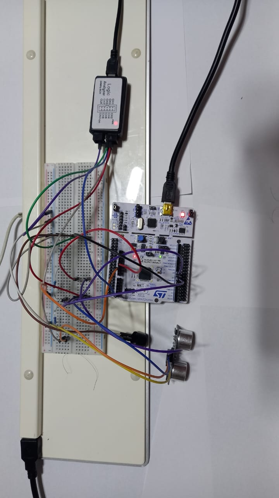
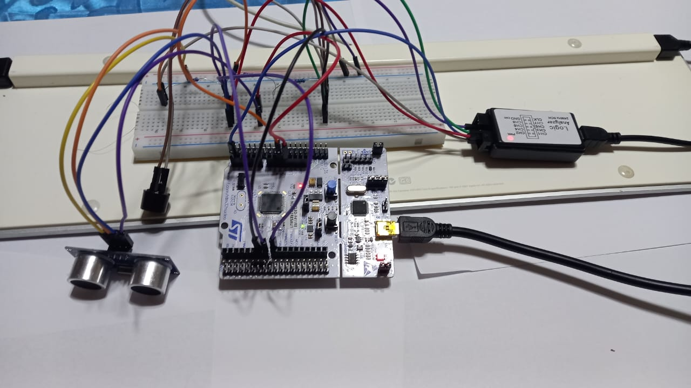

# Real-Time Obstacle Detection & Non-Intrusive Timing Analysis (STM32F411RE)

## Executive Summary
This repository contains an industrial-grade real-time obstacle detection and acoustic warning system implemented on an **ARM Cortex-M4 (STM32F411RE @ 84 MHz)** microcontroller. 

The primary objective of this project is to demonstrate **non-intrusive timing verification** and interrupt service routine (ISR) latency qualification using a USB logic analyzer (**Saleae Logic 2**). By toggling dedicated hardware GPIO test points, timing parameters and execution delays are validated at full execution speed without introducing intrusive software breakpoints.

---

## 🔌 Hardware Bench & Setup





---

## Hardware Architecture & Signal Interconnections

```text
  +-------------------+              +----------------------+
  |    STM32F411RE    |              |   HC-SR04 Ultrasonic |
  |     (Nucleo-64)   |              +----------------------+
  |                   |              | VCC  ----> +5V       |
  |  PA8 (TIM1_CH1) --+------------->| TRIG                 |
  |  PA0 (TIM2_CH1) <-+--------------| ECHO                 |
  |  GND -------------+------------->| GND                  |
  |                   |              +----------------------+
  |                   |
  |  PA5 (Heartbeat) -+----> [ LED Indicator / Debug GPIO ]
  |  PB10 (TIM2_CH3) -+----> [ Active/Passive Piezo Buzzer ]
  +-------------------+
            |
            | Non-Intrusive Logic Analyzer Probes
            v
  +-------------------+
  |   Saleae Logic 2  |
  +-------------------+
  | CH0 <--- PA8 (Trig Signal)
  | CH1 <--- PA0 (Echo Signal)
  | CH3 <--- PA5 (Heartbeat / Task Profiling Pin)
  +-------------------+
